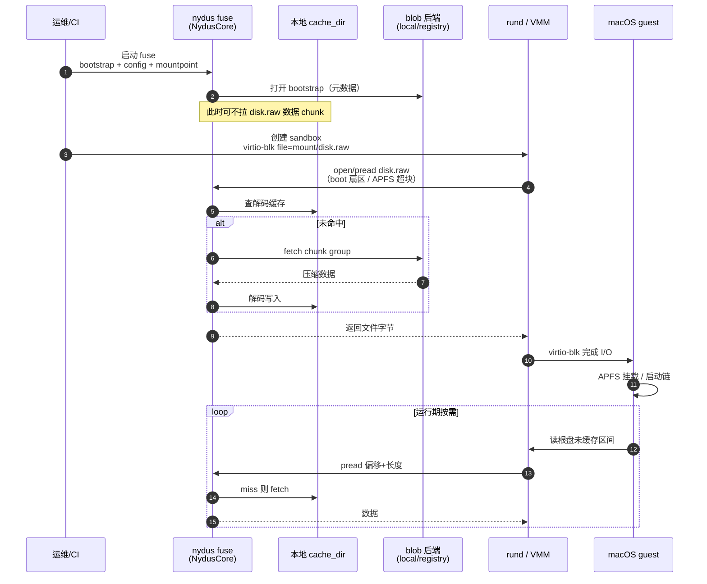

# experiment/v3-macos Phase 2：主机侧按需读（rund 优先）

> 分支：`experiment/v3-macos`  
> 前置：[`experiment-v3-macos-phase1-image-pipeline.md`](experiment-v3-macos-phase1-image-pipeline.md)  
> 状态：**架构设计 + 脚手架**；**无 golden `disk.raw`、无真实 rund 接线，不宣称 e2e 成功**

## 0. Phase 1 权威结论（本阶段不改）

1. nydus **只跑在 Linux 主机**；guest 根文件系统保持 **APFS**。  
2. **默认模型 A**：`nydus build` 把含 `disk.raw` 的目录打成 EROFS → 主机 `fuse` /（可选）`ublk`+内核 EROFS 挂出树 → VMM **virtio-blk 文件后端** 指向挂载点下的 `disk.raw`。  
3. **不要**把 Linux rund 的「guest EROFS + UFFD / virtio-pmem」当作 macOS 根盘默认路径。  
4. Runtime：**rund 优先**；runc 作为「外层 Linux wrapper + 同机读同一 `disk.raw`」的次要路径。

---

## 1. 主机侧按需架构（模型 A）

### 1.1 组件角色

| 组件 | 位置 | 职责 |
|------|------|------|
| nydus blob + bootstrap | 主机本地 / registry | 承载构建树（至少含大文件 `disk.raw`） |
| `NydusCore` | 主机进程内 | 解析 bootstrap、按需 fetch chunk、本地解码缓存、prefetch |
| `nydus fuse`（一期默认） | 主机 | 把 EROFS 文件树挂到 `/run/nydus/<id>`，VMM 以普通文件读 `disk.raw` |
| `nydus ublk` / `nydus nbd`（可选） | 主机 | 先出「flattened EROFS 块设备」，再 `mount -t erofs` 得到同一棵树；适合要内核页缓存或避免 FUSE 开销的实验 |
| rund / Dragonball / QEMU | 主机 | microVM；`virtio-blk,file=<mount>/disk.raw` |
| macOS guest | VM 内 | 只看见块设备上的 APFS；不知 EROFS/nydus |

**关键点：** 按需发生在「主机读 `disk.raw` 的哪些字节」——VMM 的 `pread`/`mmap` 落到 FUSE（或 EROFS 文件）时，触发 `NydusCore` / 存储层拉 chunk。guest 内 APFS 元数据与签名路径不变。

### 1.2 为何一期默认 FUSE 而不是 UFFD

| 路径 | 对模型 A 的贴合度 | 说明 |
|------|-------------------|------|
| **fuse** | **最高（默认）** | 直接导出「含 `disk.raw` 的目录」；VMM file backend 零改协议 |
| **ublk / nbd → mount erofs** | 中（备选） | 仍是主机 EROFS 挂载树，再 file=；多一步内核挂载，可能更稳/更快，但运维更重 |
| **uffd + virtio-pmem** | **低（非默认）** | 上游叙事是 guest 内挂 EROFS；macOS guest 不能把 EROFS 当根。仅当未来做「Linux 辅助盘」或实验模型 B 才评估 |

### 1.3 多实例与缓存

- 多个 macOS sandbox 可共享同一 `storage.cache_dir`（见 `misc/macos/config/storage.local.example.yaml`）。  
- 每个实例建议：**独立 mountpoint**（例如 `/run/nydus/macos-<id>`），避免 umount 互相踩；blob 只读、缓存共享。  
- Prefetch：冷启动前可用配置里的 prefetch scope / 后续 Phase 3 的 ondemand blob，把 boot 工作集预拉进 cache。

### 1.4 runc 包装路径（次要）

```text
主机 nydus fuse → /run/nydus/macos-a/disk.raw
        ↓ bind-mount
runc wrapper rootfs 内可见同一文件
        ↓
容器内 QEMU -drive file=/mnt/nydus/disk.raw,if=virtio,...
```

- nydus **仍建议跑在主机**（不要放进每个 wrapper 容器），减少权限与缓存分裂。  
- 与 rund 共用同一 blob / cache；只换「谁发起 VMM」。

---

## 2. 时序（rund + 模型 A）



冒烟成功判据（有 golden 盘之后，**当前未达到**）：guest 进 login 或 agent SSH ready；主机 cache 有非零增长；进程无崩溃。

---

## 3. 失败模式与处置

| 现象 | 可能原因 | 处置方向 |
|------|----------|----------|
| `phase2-smoke.sh` 非零退出，提示缺 `disk.raw` | 无 golden / 未 symlink | **预期**；用户提供盘后再跑 |
| fuse 挂上但 VMM open 失败 | 路径错、权限、SELinux、挂载未完成 | 核对 `host-mount` YAML 与 rund 配置；`test -r $MOUNT/disk.raw` |
| 启动极慢 / 大量小读 | APFS 随机读 + fetch_size 过小 / 无 prefetch | 调大 `fetch_size`；Phase 3 采 trace → optimize |
| guest 盘损坏 / 校验失败 | 构建树不是稳定 raw；或写路径误开 writable 写穿 FUSE | 一期建议 **raw 只读** + 另挂可写数据盘；或 CoW 层在 VMM（qcow2 overlay）而非改 nydus 树内文件 |
| 多实例 umount 影响其它 VM | 共用 mountpoint | 每实例独立 mountpoint；共享仅 cache/blob |
| ublk/nbd 设备残留 | 异常退出未 delete | smoke/文档要求显式 teardown；对照 `docs/ublk.md` / `docs/nbd.md` |
| 误走 UFFD-pmem | 套用 Linux rund 文档 | 回到模型 A；见 Phase 1 §2.3 |

---

## 4. 代码改动边界：nydus vs rund/VMM

### 4.1 一期尽量 **少改 nydus**

模型 A 主要是 **集成**：现有 `nydus build` + `nydus fuse`（或 ublk+erofs）+ 外部 VMM file backend。  
预期 **不必** 为 macOS 先写「raw LBA 前端」。

### 4.2 若要坚持在 nydus 内演进（可选，见 code-touches 文档）

| 区域 | 可能改动 | 优先级 |
|------|----------|--------|
| 文档/脚手架 | 本 Phase 已做 | P0 |
| `nydus fuse` 大文件顺序读性能 | 对齐 VMM 大块 pread；观测指标 | P2 |
| 配置/CLI 约定 | 固定 macos 实验用 config 样例 | P1（样例即可） |
| 模型 B：`NydusCore` raw-disk 块前端 | 新服务，工作量大 | 后期 |
| UFFD 路径 | **非** macOS 根盘默认 | 不做 |

### 4.3 rund / VMM 侧（仓外或用户环境）

| 项 | 说明 |
|----|------|
| 配置 schema | 指向主机 `disk.raw` 绝对路径；固件 OpenCore/OVMF 自备 |
| 生命周期 | 先起 nydus mount → 再 create VM；停机先停 VM 再 umount |
| 可写策略 | overlay/qcow2 或第二块 virtio-blk；避免直接写 FUSE 上的系统盘 |
| runc | bind-mount 同一文件进 wrapper；QEMU args 与 rund 对齐 |

详细接线笔记：[`misc/macos/phase2/rund-wiring.md`](../misc/macos/phase2/rund-wiring.md)。  
上游 touch 清单：[`experiment-v3-macos-phase2-code-touches.md`](experiment-v3-macos-phase2-code-touches.md)。

---

## 5. 脚手架与阻塞项

### 5.1 本仓交付

```text
docs/experiment-v3-macos-phase2-host-ondemand.md   # 本文
docs/experiment-v3-macos-phase2-code-touches.md    # 建议改动的上游文件清单
misc/macos/phase2/
  host-mount.example.yaml                          # 主机挂载配置示例
  rund-wiring.md                                   # rund/VMM 接线说明
  phase2-smoke.sh                                  # 二进制/路径检查；缺 disk.raw 明确失败
```

### 5.2 阻塞（用户侧）

在提供之前，**不能**声称 Phase 2 冒烟通过：

1. 合法可启动的 golden **`disk.raw`**（或可转换的 qcow2→raw）  
2. 带 **KVM** 的 Linux 机 + 可用的 **rund**（或 QEMU+OpenCore）接线  
3. （可选）已 `nydus build` 出的 bootstrap/blob，或允许现场 build 的构建树

`phase2-smoke.sh` 在缺盘时必须 **exit ≠ 0** 并打印清晰原因——这是设计行为，不是 bug。

---

## 6. Phase 2 出口标准（有盘之后）

- [ ] `nydus fuse`（或文档记载的 ublk 路径）挂出树，且 `$MOUNT/disk.raw` 可读  
- [ ] rund/QEMU 以 file backend 启动，guest 到达约定 ready（SSH/login）  
- [ ] 第二次启动可见 cache 命中带来的时间下降（粗测即可）  
- [ ] 失败与 teardown 步骤写入操作笔记  

当前（无盘）：仅文档 + 脚手架勾选完成。
